

 

 

 

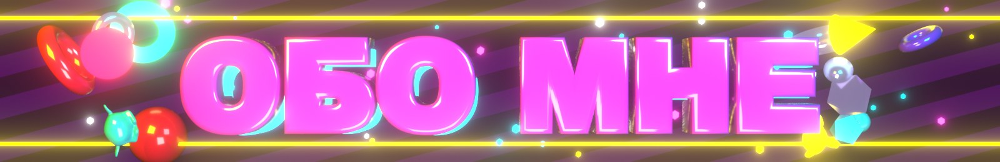

<table>
  <tr>
    <td width="58%" valign="top">

### 👾 Кто я

- 🌀 **Вайбкодер.** Придумываю, ставлю задачи ИИ и довожу до результата.
- 🩸 Запустил **Windows-игру на Android без Wine** ([Isaac Port](https://github.com/Veeva61/Isaac-Android)).
- 🧬 Загрузчики PE, эмуляция x86 → arm64, перевод OpenGL → OpenGL ES.
- 👁️ Боты на компьютерном зрении с прозрачными оверлеями поверх игр.
- 🧩 Моды для Unity-игр на IL2CPP: BepInEx, Cpp2IL, дампы метаданных.
- 🎨 Эффекты на C# и 3D в **Blender**: шапка, заголовки и анимация на этой странице оттуда.
- 📱 Главный тестовый стенд: **Pixel 10 Pro**.

> **Девиз:** если игра не запускается на телефоне,
> значит, телефон ещё не знает, что она запускается.

</td>
    <td width="42%" align="center" valign="middle">
      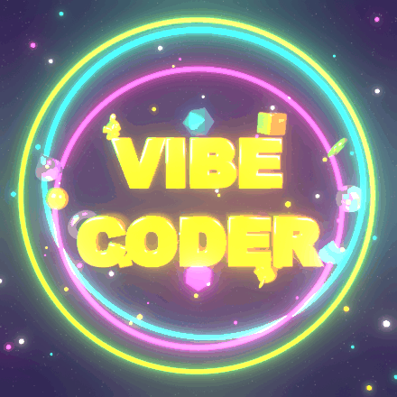
    </td>
  </tr>
</table>

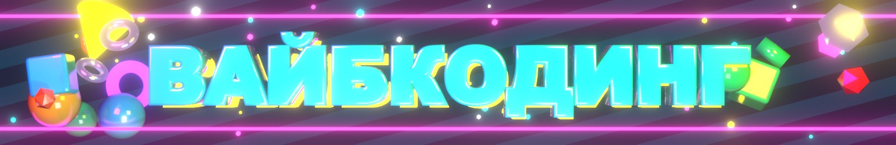

### 🌀 Как я пишу код

➜

➜

➜

➜

> [!TIP]
> **Вайбкодинг** — это когда код пишет ИИ, а человек отвечает за всё остальное: идею, архитектуру,
> проверку на настоящем устройстве и упрямство, чтобы довести дело до конца.
> Isaac Port — свой загрузчик PE, Win32 и перевод графики — сделан именно так.

| 🎛️ Вайб-метрика | 📈 Значение |
| :--- | :---: |
| Строк, набранных руками | подозрительно мало |
| Промптов на одну фичу | от 1 до «ну ещё разок» |
| Игр, запущенных там, где не должны | 1 и растёт |
| Скорость Lua-теста на Pixel 10 Pro | 5,4 с → **1,8 с** |
| Уровень вайба |  |

**Инструменты вайба**

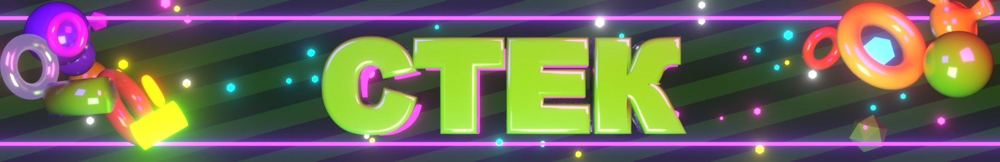

 

  

 

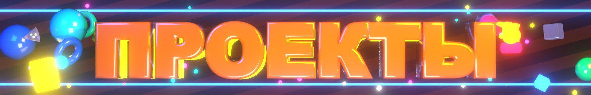

## 🩸 [Isaac Port](https://github.com/Veeva61/Isaac-Android)

**The Binding of Isaac: Repentance+ на Android, без Wine**

Свой загрузчик PE · своя реализация Win32 · OpenGL → OpenGL ES · x86 на arm64 через box64

<table>
  <tr>
    <td></td>
    <td></td>
    <td></td>
  </tr>
  <tr>
    <td align="center">🎬 Титульный экран</td>
    <td align="center">🕹️ Экранный геймпад</td>
    <td align="center">🧩 Менеджер модов</td>
  </tr>
</table>

### 🔧 В мастерской

| 👁️ Боты на компьютерном зрении | 🧩 Моды для Unity | 🌀 Эффекты на C# |
| :---: | :---: | :---: |
| C++ · OpenCV · оверлеи | BepInEx · IL2CPP · Cpp2IL | золотая спираль, растр |

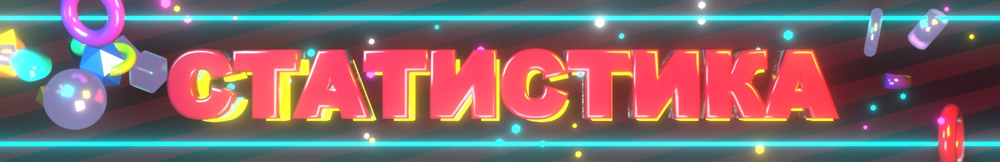

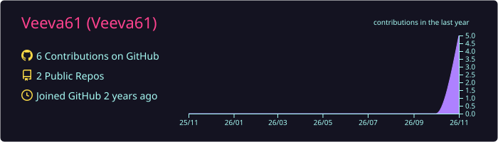

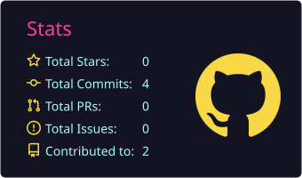
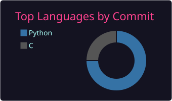
 
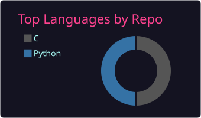
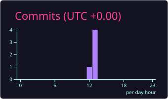

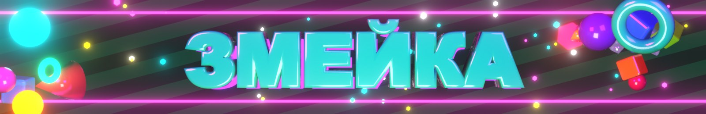

<picture>
  <source media="(prefers-color-scheme: dark)" srcset="https://raw.githubusercontent.com/Veeva61/Veeva61/output/github-snake-dark.svg">
  <source media="(prefers-color-scheme: light)" srcset="https://raw.githubusercontent.com/Veeva61/Veeva61/output/github-snake.svg">
  
</picture>

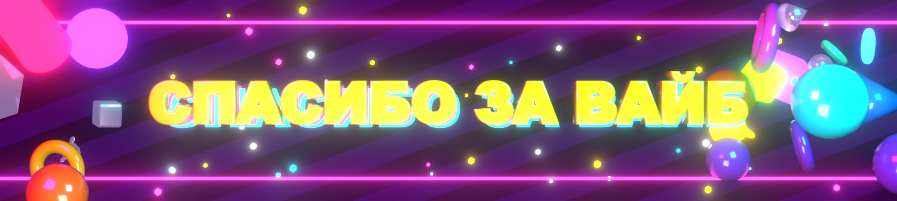

🩷 Шапка, заголовки и анимация отрендерены в Blender 5.2 · страница собрана вайбкодингом вместе с Claude Code 🩷

