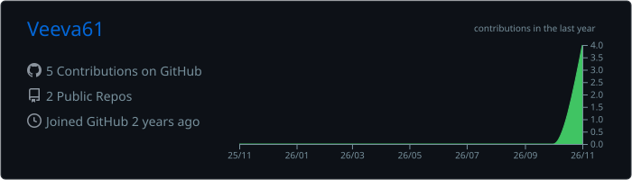
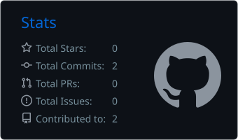
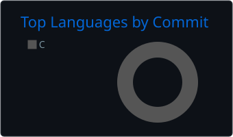

 

## 👾 Обо мне

- 🔧 Люблю залезать внутрь программ: загрузчики, эмуляция, реверс, низкоуровневая графика.
- 📱 Сейчас делаю **[Isaac Port](https://github.com/Veeva61/Isaac-Android)**: запускаю Windows-игру на Android без Wine.
- 👁️ Пишу ботов на компьютерном зрении (OpenCV, C++) с оверлеями поверх игр.
- 🧩 Делаю моды для Unity-игр на IL2CPP (BepInEx, Cpp2IL).
- 🎨 Иногда рисую визуальные эффекты на C# и делаю модели в Blender.

## 🛠️ Стек

 

## 🚀 Проекты

<table>
  <tr>
    <td width="45%">
      
    </td>
    <td>
      <h3><a href="https://github.com/Veeva61/Isaac-Android">🩸 Isaac Port</a></h3>
      The Binding of Isaac: Repentance+ на Android без Wine.
        
      Свой загрузчик PE, своя реализация Win32, перевод OpenGL → OpenGL ES, x86 на arm64 через box64.
      Экранный геймпад, менеджер модов, перенос сохранений.
        
      
      
      
      
    </td>
  </tr>
</table>

## 📊 Статистика

## 🐍

<picture>
  <source media="(prefers-color-scheme: dark)" srcset="https://raw.githubusercontent.com/Veeva61/Veeva61/output/github-snake-dark.svg">
  <source media="(prefers-color-scheme: light)" srcset="https://raw.githubusercontent.com/Veeva61/Veeva61/output/github-snake.svg">
  
</picture>

