

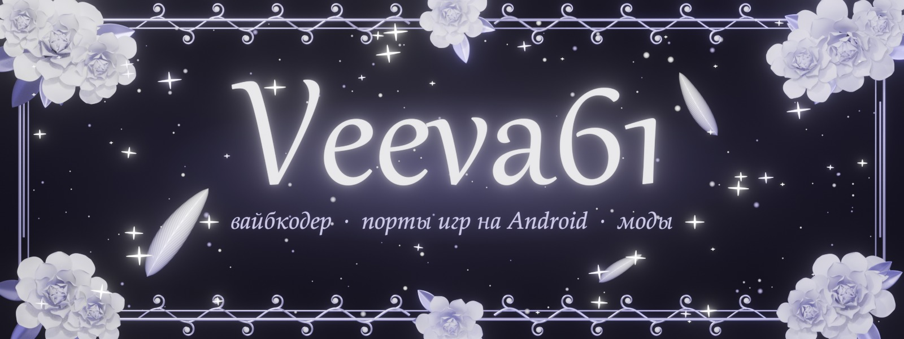

 

 

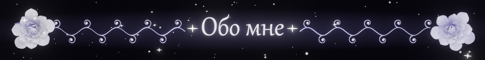

<table>
  <tr>
    <td width="58%" valign="middle">

- 🤍 **Вайбкодер:** придумываю, ставлю задачи ИИ и довожу до результата.
- 🕊️ Порт Windows-игры на Android без Wine: [**Isaac Port**](https://github.com/Veeva61/Isaac-Android).
- ✧ Загрузчики PE, эмуляция x86 → arm64, перевод OpenGL → OpenGL ES.
- 🌙 Боты на компьютерном зрении и моды для Unity-игр на IL2CPP.
- 🌸 3D в **Blender**: розы, рамки и перья на этой странице оттуда.
- 📱 Тестовый стенд: **Pixel 10 Pro**.

> 💬 *Не кусаюсь (почти)*

</td>
    <td width="42%" align="center" valign="middle">
      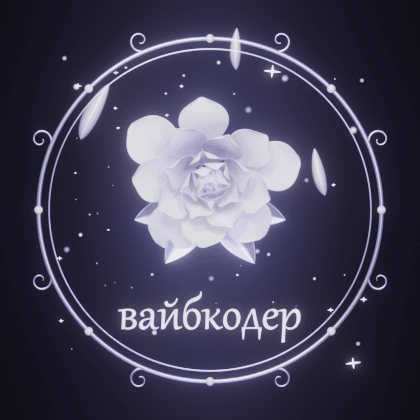
    </td>
  </tr>
</table>

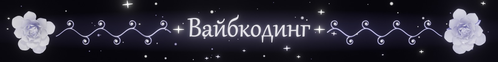

*Код пишет ИИ, а на мне всё остальное:*
*идея, архитектура, проверка на настоящем телефоне и упрямство довести дело до конца.*

**идея** ✧ **промпт** ✧ **Claude Code** ✧ **проверка на Pixel 10 Pro** ✧ **релиз**

| | |
| :--- | :--- |
| 🕯️ Строк, набранных руками | подозрительно мало |
| 🪶 Промптов на одну фичу | от одного до «ну ещё разок» |
| 🌹 Игр, запущенных там, где не должны | одна, и это только начало |

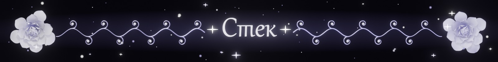

 

  

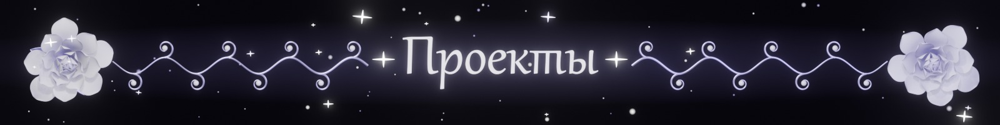

### 🕊️ [Isaac Port](https://github.com/Veeva61/Isaac-Android)

*The Binding of Isaac: Repentance+ на Android, без Wine*

Свой загрузчик PE · своя реализация Win32 · OpenGL → OpenGL ES · x86 на arm64 через box64

<table>
  <tr>
    <td></td>
    <td></td>
    <td></td>
  </tr>
  <tr>
    <td align="center">титульный экран</td>
    <td align="center">экранный геймпад</td>
    <td align="center">менеджер модов</td>
  </tr>
</table>

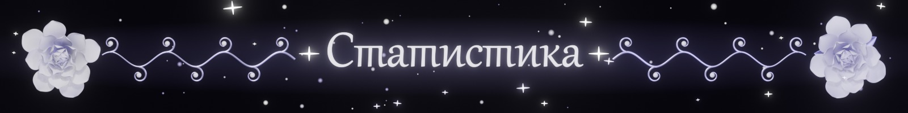

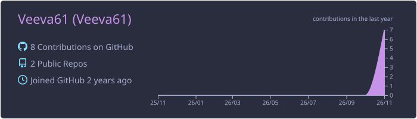

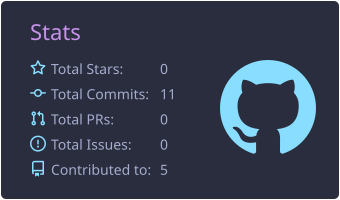
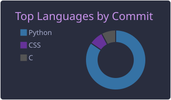

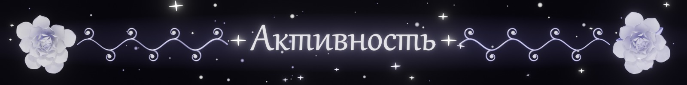

<picture>
  <source media="(prefers-color-scheme: dark)" srcset="https://raw.githubusercontent.com/Veeva61/Veeva61/output/github-snake-dark.svg">
  <source media="(prefers-color-scheme: light)" srcset="https://raw.githubusercontent.com/Veeva61/Veeva61/output/github-snake.svg">
  
</picture>

 

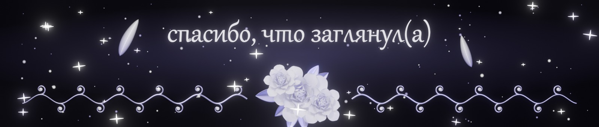
